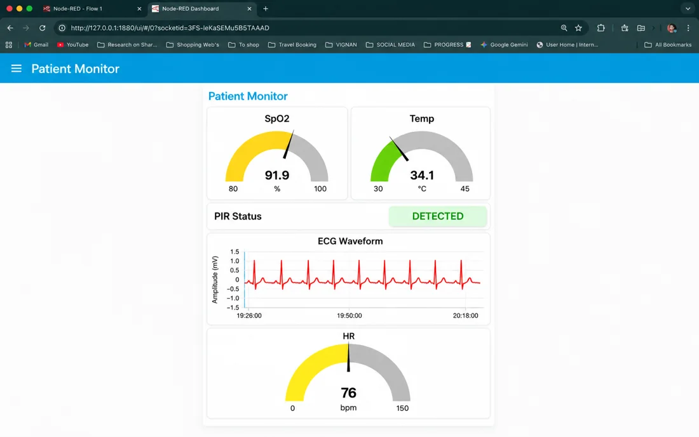
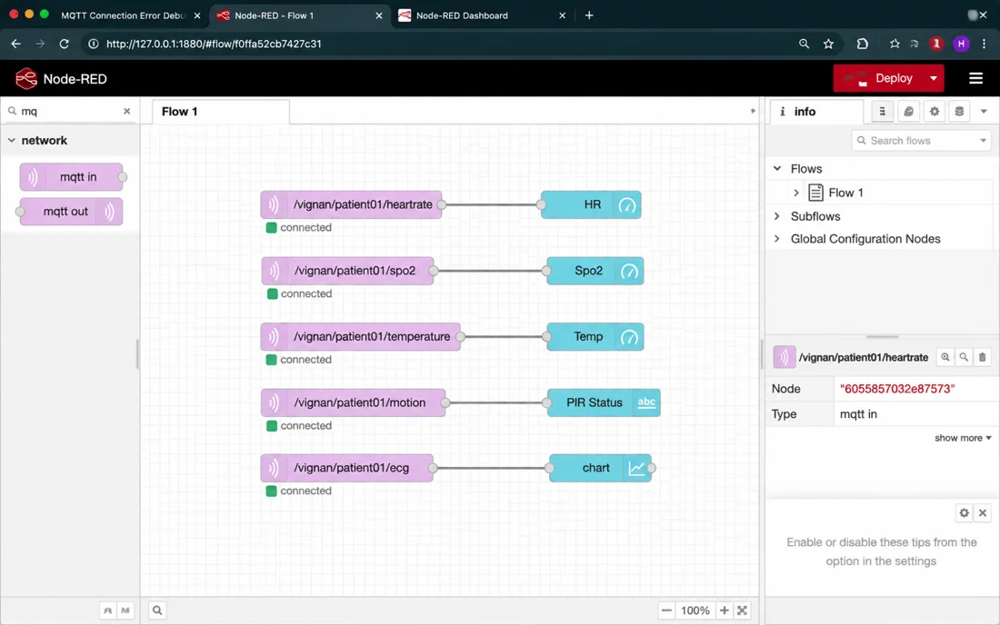
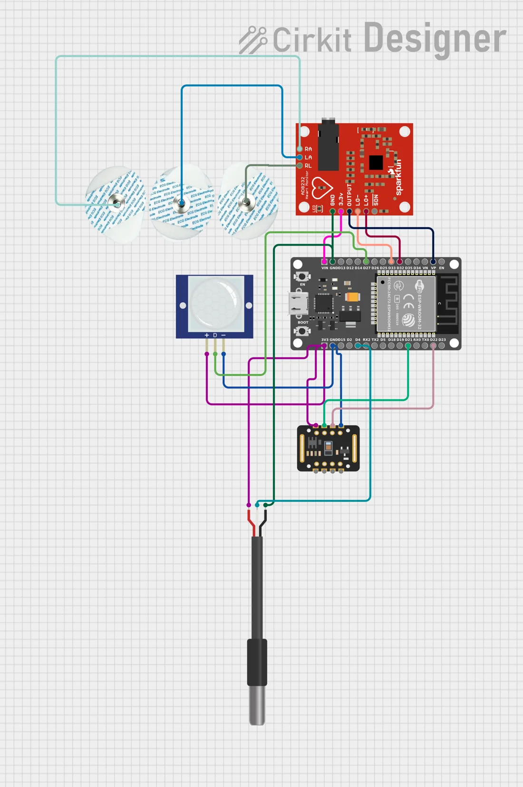

# Resilient IoT for Remote Health Monitoring

An edge-based ESP32 patient monitor that keeps working on weak or intermittent networks. The ESP32 does local acquisition and preprocessing, publishes readings over MQTT, and a Node-RED dashboard shows them live.

> Academic prototype (inter-departmental project, Vignan's Foundation for Science, Technology & Research, Aug–Dec 2025). It is not a clinically validated medical device.

## What it measures

| Signal | Sensor | Rate |
|---|---|---|
| ECG | AD8232 | raw ADC value published every 2 s; leads-off detection |
| Heart rate and SpO2 | MAX30102 | 100 samples/s; 4-beat moving average |
| Body temperature | DS18B20 | non-blocking conversion, read every 2 s |
| Motion | PIR sensor | read every 2 s; ignored for the first 60 s (warm-up) |

## How it works

1. The ESP32 acquires the sensor signals and preprocesses them locally (edge processing).
2. Readings are published over Wi-Fi with MQTT, one topic per signal: `heartrate`, `spo2`, `temperature`, `motion`, `ecg` and `alert` under `/vignan/patient01/`. All values are published every 2 seconds.
3. If the MQTT connection drops, the firmware retries every 5 seconds without blocking sensor reading. Readings taken while offline are not stored.
4. An `alert` message (`BRADYCARDIA` below 50 bpm, `TACHYCARDIA` above 120 bpm) is published when the averaged heart rate crosses those limits.
5. A Node-RED dashboard subscribes to the topics and shows SpO2, temperature, motion status, the ECG waveform and heart rate.

## Firmware

[`firmware/resilient_iot_esp32.ino`](firmware/resilient_iot_esp32.ino) (Arduino IDE, ESP32 board package).

Libraries: PubSubClient, SparkFun MAX3010x (`MAX30105.h`), OneWire, DallasTemperature.

| Signal | ESP32 pin |
|---|---|
| ECG output (AD8232) | GPIO 36 (leads-off: GPIO 32, 33) |
| PIR | GPIO 27 |
| DS18B20 | GPIO 4 |
| MAX30102 (I2C) | SDA 21, SCL 22 |

Before flashing, replace `YOUR_WIFI_SSID` and `YOUR_WIFI_PASSWORD`. The prototype publishes to the public HiveMQ broker (`broker.hivemq.com:1883`) without encryption or authentication, so use only non-identifying test data. A private broker with TLS and credentials is needed for anything beyond a demonstration.

## Screenshots and diagrams

| | |
|---|---|
|  |  |
| Node-RED dashboard | Node-RED flow, one MQTT topic per signal |

Wiring diagram drawn in Cirkit Designer.

## My role

Team lead in a team of 3: system design, sensor integration, MQTT communication and the Node-RED dashboard.

## Limitations

- Prototype only. No clinical validation, and not for diagnosis or treatment.
- The dashboard screenshot is a demonstration view.
- SpO2 is a simple linear estimate from the red/IR ratio and is not calibrated against a reference oximeter.
- No offline data storage; readings are lost while the broker is unreachable.
- The Node-RED flow export is not yet in this repository.

## Security note

Never commit Wi-Fi passwords, MQTT broker credentials or tokens. Keep them in a local file that is listed in `.gitignore`.
